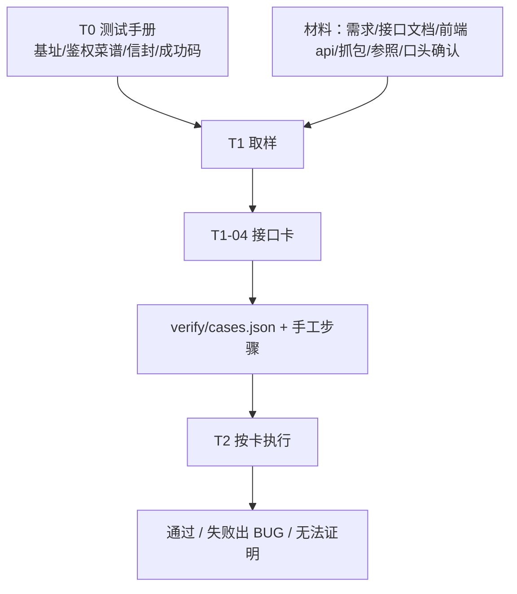

# 生命周期（software-test-sop）

## 阶段与出口

```
T0 测试手册（跨需求通识）
   │
T1 设计与取样 ──接口卡已取样 + cases 与卡一致──▶ T2 按卡执行 ──结果──▶ 通过 / 失败→T3 / 无法证明
                                 ▲                      │
                                 └─ 回炉改卡 ◀─ 卡与环境不一致 ─┘
```



出口须可判定。

| 阶段 | 出口 |
|------|------|
| T0 | 基址、鉴权菜谱、信封、探活、角色矩阵写全 |
| T1 | AC 有执行方式；verify 类 AC 的接口卡「已取样」；cases 只引用卡上字段 |
| T2 | 本轮每条有结果与证据（通过 / 失败 / 无法证明 / 未执行） |
| T3 | 缺陷单可复现（契约字段齐） |

T0 不全 → **禁止进入该项目的 T2 并宣称接口验收通过**（可先做 T1 范围拆解）。

## 事实两层

| 层 | 放哪 | 放什么 | 多久变 |
|----|------|--------|--------|
| 项目通识 | `T0-01-测试手册` | 基址规则、鉴权菜谱、信封与成功码、角色申请、库查入口、复位、探活 | 跨需求；变了改手册 |
| 本需求契约 | `T1-04-接口卡`（+ 页面卡） | 每个可调入口的 method/path/头/入参/成功失败观察/出处 | 每需求取样；接口变了重取样 |

**T2 不负责发现接口**：只读 T0 + T1-04 + cases。手册/卡与真环境不一致 → 记 BUG 或回 T1 改卡，**不现场发明参数**。

## 取样优先级（高→低）

对每个验收点，取到「可调用」为止，接口卡写 **出处**：

1. 已有接口说明或 Postman/OpenAPI  
2. 前端 API 模块走读（常量前缀 + 方法 path，对照页面触发点）  
3. 后端 Controller 走读（有代码读权限时）  
4. 浏览器/代理抓包（脱敏后入库）  
5. 手册「参照」——同类已验过的列表/提交/审批  
6. 仍未知 → 开口必问（一次问齐：基址是否变更、path、必填参、成功/失败样例）；未答复前该 AC **不进 verify**，标「待取样」

纯 UI（无接口）→ **页面卡**：菜单路径、选择器/稳定文案、期望可见态；执行列标「手工」。

## 缺事实就停问

- 不知道基址/鉴权 → 回 T0 补，或对开发/环境开口；**禁止猜**。  
- 不知道 path/body → 该 AC 待取样；不进 cases；不宣称通过。  
- T2 执行时缺事实 → 该条「未执行」或「无法证明」，附缺什么。  
- 禁止用臆造 path/body 冒充验收证据。

## 门禁与证据

三态：**通过 / 失败 / 无法证明**。「无法证明」≠通过。

| 门禁 | 证明 | 「无法证明」何时 |
|------|------|------------------|
| T0 通识 | 手册字段齐；探活命令本环境跑通 | 无探活结果 / 鉴权菜谱缺步 |
| 接口卡取样 | 出处可开；成功样例（失败样例若 AC 含反例） | 标待取样未关闭 |
| cases↔卡 | cases 的 path/头/body 键均在卡上 | cases 出现卡外字段 |
| 行为符合 AC | `out.txt` / 手工记录 / 截图或查库摘录 | 未执行；环境不可达且无法代跑 |
| 缺陷可复现 | T3 复现步骤在本环境可照做 | 偶发无稳定条件 |

自造桩、本地 mock 当真环境 = 自测，不算项目验收证据。

## 接包最小集

不要求开发 SOP 产物。至少具备：

1. 范围与验收点（可写成 AC）  
2. 环境可达（或明确由谁代跑）  
3. 鉴权菜谱（或写入 T0 的待补项并开口）  
4. 至少一种可调入口（接口或页面）  
5. 可判定期望  

缺 → 停在「有一个问题」；能拆的先拆，不能验收的标待取样。

## 执行循环（T2）

一轮 = 执行计划 + 结果。**r1 建议顺序**：手册探活 → 本需求 1 条主路径 verify → ≤8 冒烟 → 再铺开。主路径先打通「基址+鉴权+path+主 body」。

| | T1（设计期） | T2（执行期） |
|--|-------------|-------------|
| 验证什么 | 范围可测、事实够、用例可判定 | 行为符合卡与 AC |
| 怎么证明 | 卡有出处；探活跑通；r1/r2 已切分 | 跑 verify；手工按页面卡；查库/外部按步骤 |
| 不知道地址/鉴权 | 回 T0 或开口 | 不猜；未执行 / 无法证明 |
| 卡与环境不一致 | — | 实际响应进结果 → BUG 或回炉改卡 |

失败项 → T3 出 `BUG-xx`。卡错误（出处过时）→ 回 T1 改卡再跑，不把文档错写成实现错（除非已证明实现也错）。

## 当前位置

`00-当前位置`：阶段/轮次/阻塞/下一步每格一行、短写。对话末条只发「你要做的」。

| 停在 | 你要做的 | 只看 |
|------|----------|------|
| T0 不全 | 补手册缺项或答复探活/鉴权问题 | `T0-01` |
| T1 待取样 | 按必问逐条回 path/入参/样例；或提供抓包/文档 | `T1` 待取样表 |
| T1 待确认范围 | 回「范围确认」或指出增删 AC | 范围与验收 |
| T2 待执行 | 跑 verify / 按页面卡手工；带回 out.txt 与结果 | `T1/verify`、执行计划 |
| T3 待确认 | 确认 BUG 优先级/指派或补充复现 | `T3` BUG 单 |

## 单一真相源

| 东西 | 唯一存放 | 别处 |
|------|----------|------|
| 基址/鉴权/信封/探活 | `T0-01` | 引章节 |
| AC / 执行方式 | T1 范围与验收 | 引 AC-xx |
| 接口契约（可调） | `T1-04` | cases 只引用 |
| 页面契约 | T1 页面卡 | 手工步骤引用 |
| 执行结果 | `T2-01-结果-r{N}` | 证据目录 |
| 缺陷 | `T3` `BUG-xx` | 不使用开发 S3 的 A/B/C/D |

## 不做的事

不做开发实现与改码分流；不在 T2 发现接口；不做大型框架生成；skill 不写死项目 URL/服务名。
